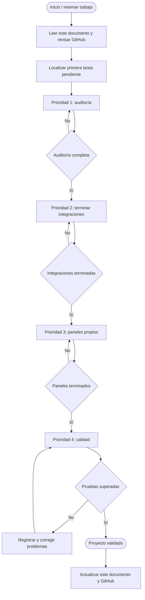
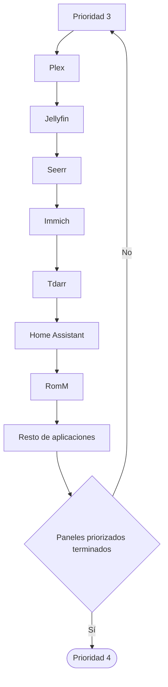
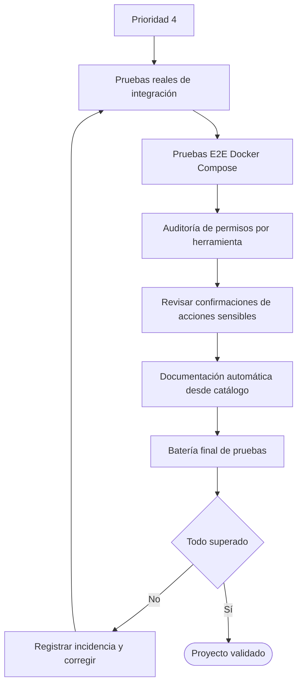

# HomeLabPilot — Flujo maestro de auditoría y desarrollo

> **Documento de referencia único para continuar el proyecto.** Antes de cada sesión de trabajo hay que leer este archivo y continuar desde el primer nodo pendiente. Después de cada tarea completada, actualizar aquí el estado y el registro.

- **Repositorio:** `rubenseglop/mcp-HomeLabPilot`
- **Rama de trabajo:** `feature/complete-homelabpilot` (base `main` en `a5ddc62`)
- **Última actualización:** 2026-11-24
- **Fase activa:** Desarrollo integral — correcciones y funcionalidades
- **Estado global:** EN CURSO
- **Autorización de trabajo:** El 23-11-2026 el usuario indicó abandonar las comprobaciones repetitivas y pasar directamente a programar. Se permite modificar código en la rama feature; `main` permanece intacta.

## 1. Flujo general

## 2. Prioridad 1 — Comprobar todo lo existente

### 1.1 Código y despliegue

| Tarea | Estado | Resultado / observaciones |
|---|---|---|
| Comprobar repositorio y rama `main` | COMPLETADO | Repositorio `rubenseglop/mcp-HomeLabPilot` |
| Comprobar árbol de trabajo limpio | COMPLETADO | Sin cambios pendientes en la comprobación del 23-11-2026 |
| Contrastar commit del servidor con GitHub | COMPLETADO | `44985e1` (comprobación previa del 23-11-2026) |
| Confirmar que el contenedor ejecuta exactamente ese código | COMPLETADO | Cinco hashes SHA-256 idénticos entre checkout local y `/app` en el contenedor; ejecuta el código del checkout `44985e1` |

### 1.2 Herramientas MCP

| Tarea | Estado | Resultado / observaciones |
|---|---|---|
| Ejecutar `tools/list` | COMPLETADO | Respuesta JSON-RPC correcta |
| Registrar recuento real | COMPLETADO | **187 herramientas** publicadas |
| Aclarar diferencia respecto a las 189 previstas | COMPLETADO | En el checkout desplegado entonces: 189 declaraciones `@mcp.tool`, 187 nombres únicos por dos duplicados; coincide con `tools/list` (187). En la rama feature actual: 199 declaraciones, 197 nombres únicos; los mismos dos duplicados. |
| Revisar herramientas duplicadas, ausentes o inesperadas | PARCIAL | Confirmados dos nombres duplicados (`cleanuparr_get_health`, `maintainerr_get_health`); las dos versiones consultan el mismo endpoint GET. Clasificación estática del proxy: 133 nombres permitidos y 54 bloqueados; entre los bloqueados hay lecturas legítimas de Seanime (`seanime_search_anime`, `seanime_verify_reassignment`, `seanime_audit_library`, `seanime_inspect_entry`) y el helper puro `collection_has_media_id`. Comparación estática feature completada: 201 nombres únicos frente a 148 permitidos; los 53 restantes permanecen denegados por defecto y están clasificados. Pendiente comparar con inventario runtime actualizado y validar semántica individual antes de ampliar la allowlist |

### 1.3 Integraciones

| Tarea | Estado | Resultado / observaciones |
|---|---|---|
| Ejecutar `stack_status` | COMPLETADO | 10 de 10 servicios configurados respondieron correctamente |
| Revisar versiones y campos no disponibles | PARCIAL | Bazarr, Seanime, Jellyfin y Tdarr no devolvieron versión; no equivale a fallo de conectividad |
| Revisar implementación de `integration_catalog` | PARCIAL | Código inspeccionado: 20 integraciones HTTP adicionales y 4 no HTTP; Seanime está declarado también en el bloque principal y su modo se sobrescribe en el catálogo. Falta ejecución funcional para verificar la configuración real |

### 1.4 Proxy MCP, Codex y permisos

| Tarea | Estado | Resultado / observaciones |
|---|---|---|
| Comprobar endpoint de salud del proxy | COMPLETADO | HTTP 200; modo `read-only` |
| Comprobar salud del gateway de agentes | COMPLETADO | HTTP 200 |
| Verificar autenticación/configuración MCP de Codex | PARCIAL | Gateway informó `authenticated=true` y `mcp_configured=true`; falta probar una llamada real a través del proxy |
| Revisar autenticación Bearer del MCP principal | COMPLETADO EN FEATURE | `_BearerAuthMiddleware` exige el token completo con comparación constante; se añadieron pruebas para token ausente, incorrecto y correcto. CI pendiente. |
| Ejecutar `tools/list` a través del proxy | COMPLETADO | 23-11-2026: initialize HTTP 200, sesión creada, tools/list HTTP 200, 137 herramientas visibles con la política anterior, sin error JSON-RPC. La nueva allowlist explícita contiene 148 herramientas (lecturas aprobadas de forma exacta, incluidas Questarr, Frigate, Seanime settings y Recyclarr status); pendiente desplegar y verificar el nuevo resultado. |
| Ejecutar una herramienta de lectura a través del proxy | PARCIAL | Prueba aislada del handler con lectura aprobada y cabecera Bearer superada; pendiente E2E real tras despliegue autorizado |
| Verificar bloqueo de herramientas de escritura en el proxy | PARCIAL | COMPLETADO EN FEATURE mediante pruebas del handler real: las escrituras Seanime/Tdarr se rechazan antes de llamar al upstream. Pendiente E2E contra el proxy desplegado, sin invocar mutaciones reales |
| Verificar que las lecturas siguen permitidas | PARCIAL | COMPLETADO EN FEATURE: `tdarr_search_files` atraviesa el handler con Bearer; `tools/list` filtra exactamente las lecturas. Pendiente llamada real contra el proxy desplegado |

**Criterio para cerrar Prioridad 1:** todas las tareas deben estar COMPLETADAS o tener una excepción documentada y aceptada. Los estados PARCIAL y BLOQUEADO no cierran una fase.

## 3. Prioridad 2 — Terminar las integraciones

| Tarea | Estado | Alcance |
|---|---|---|
| Questarr | PARCIAL | API de lectura y panel en catálogo con estado/biblioteca; credencial `read`, límites y pruebas unitarias. CI de la rama superado (run 410); pendiente validación real. |
| Frigate | PARCIAL | API de estadísticas/eventos/revisión y panel en catálogo; bearer JWT, solo lectura y paginación acotada. Pendiente CI del panel y validación real. |
| Recyclarr | PARCIAL | Estado del contenedor y ejecución fija `recyclarr sync` mediante Docker Gateway, limitada a contenedor configurado/allowlist y preview firmado con confirmación exacta. Panel en catálogo y CI de la rama superado (run 410); pendiente prueba real. |
| Docker Gateway | PARCIAL | Gateway limitado a lista explícita y start/stop/restart más comando fijo Recyclarr sync. Las acciones MCP y el panel web requieren preview firmado, comprobación previa de allowlist y confirmación escrita. CI de la rama superado hasta `a6e3b60` (run 410); pendiente validación real con el perfil Docker habilitado. |
| Seanime — gestión de configuración | COMPLETADO EN FEATURE | `seanime_get_settings` lee `/api/v1/settings` con redacción de passwords/tokens/API keys. `seanime_preview_update_setting` y `seanime_confirm_update_setting` permiten únicamente preferencias booleanas de bajo riesgo con permiso `admin`, preview firmado, revalidación del valor actual y confirmación exacta. Los cambios usan el endpoint oficial `PATCH /api/v1/settings/path`; las credenciales, rutas, clientes y ajustes sensibles quedan fuera de la allowlist. CI runs 428–430 superados; pendiente validar en la instalación real tras autorización de despliegue. |

## 4. Prioridad 3 — Paneles propios

| Aplicación | Estado |
|---|---|
| Plex | PARCIAL | Panel de bibliotecas, añadidos recientes globales y por sección, reproducción activa y On Deck; pendiente validación real. |
| Jellyfin | PARCIAL | Panel de servidor, bibliotecas, sesiones y búsqueda de elementos; pendiente validación real. |
| Seerr | PARCIAL | Panel de estado, cola de solicitudes, datos de aplicación y búsqueda de películas/series; pendiente validación real. |
| Immich | PARCIAL | Panel de estadísticas, álbumes y búsqueda de fotos/vídeos por metadatos; búsqueda usa POST de consulta sin mutación; pendiente validación real. |
| Tdarr | COMPLETADO EN FEATURE | Cinco herramientas de lectura (estado, nodos, búsqueda, informes paginados y detalle de informe) y dos flujos de escritura (reencolar hasta 50 archivos y reescanear un archivo) con permiso `operations`, preview firmado y confirmación exacta. Pruebas unitarias específicas añadidas; CI run 434 superado (suite completa; fallos intermedios 431–433 corregidos y sustituidos); validación real pendiente de despliegue autorizado tras autorización de despliegue. |
| Home Assistant | PARCIAL | Panel de configuración, estados, catálogo de servicios, consulta individual de entidades e historial por intervalo ISO-8601; operaciones del panel exclusivamente de lectura. Corregida la validación del formato `domain.object_id`. CI run 455 superado; pendiente validación visual y funcional en la instalación real. |
| RomM | PARCIAL | Panel de plataformas, listado de juegos y colecciones ampliado con búsqueda por nombre y consulta de metadatos de un juego por ID; solo lectura y paginación acotada. CI run 458 superado; pendiente validación real en la instalación. |
| Seanime | COMPLETADO EN FEATURE | Biblioteca, AniList, seguimiento, auditoría, inspección, archivos sin match y auto-downloader; ajustes booleanos seguros, añadir a AniList y reasignar archivos con preview firmado/confirmación exacta. Pruebas de redacción de secretos, permisos, token obsoleto, confirmación exacta y cambios concurrentes. Pendiente validación real tras despliegue autorizado. |
| Resto de aplicaciones, priorizadas por utilidad | PARCIAL | Añadidos paneles de solo lectura para BookOrbit, Tidarr, Youtarr, Pulsarr, Cleanuparr, Maintainerr, Agregarr, Tracearr, Cloudflare, Transmission, FlareSolverr y tinyMediaManager; BookOrbit incluye búsqueda/detalle/distribución de formatos; Youtarr búsqueda y detalle de vídeos; Tidarr estado de cola; Agregarr actividad y solicitudes de elementos ausentes. Pendiente revisión de cobertura y validación real. |

## 5. Prioridad 4 — Calidad y validación final

| Tarea | Estado |
|---|---|
| Pruebas reales de integración | PENDIENTE |
| Pruebas E2E de Docker Compose | PENDIENTE |
| Comprobar permisos de cada herramienta | PENDIENTE |
| Comprobar flujos de preview y confirmación de operaciones sensibles | PENDIENTE |
| Generar/actualizar documentación automáticamente desde el catálogo real | PENDIENTE |
| Ejecutar batería final de pruebas | PENDIENTE |
| Registrar versión y resultados finales | PENDIENTE |

### Mejora solicitada — herramientas por servicio en Estado de servicios

| Tarea | Estado | Detalle |
|---|---|---|
| Mostrar el número de herramientas MCP disponibles en cada servicio conectado | COMPLETADO EN FEATURE | `stack_status` añade el recuento y el catálogo de herramientas registradas por prefijo de servicio para servicios configurados y saludables. |
| Añadir listado desplegable por aplicación | COMPLETADO EN FEATURE | Cada tarjeta muestra «X herramientas disponibles» y despliega nombre y descripción de cada herramienta; no se listan herramientas de servicios desconectados. |
| Validar visualmente en despliegue real | PENDIENTE | Requiere desplegar la rama feature después de cerrar la auditoría y autorización del usuario. |

## 6. Registro de comprobaciones

| Fecha | Comprobación | Resultado |
|---|---|---|
| 2026-11-23 | Repositorio, rama y commit | Checkout del servidor `44985e1`; GitHub `main` `a5ddc62`; rama de trabajo creada desde GitHub `main` |
| 2026-11-23 | `stack_status` | 10/10 servicios configurados responden correctamente |
| 2026-11-23 | MCP `tools/list` | 187 herramientas; sin error JSON-RPC |
| 2026-11-23 | CI de mejora de inventario por servicio | run 410 (`a6e3b60`) completado con `success`; tests Python, Node y comprobación de sintaxis JS superados |
| 2026-11-23 | Proxy `/health` | HTTP 200; modo `read-only` |
| 2026-11-23 | Pruebas aisladas del handler MCP proxy | CI run 440 (`d68ddb7`) `success`: denegación previa al upstream de mutaciones Seanime/Tdarr, lecturas permitidas, Bearer, batch atómico y filtrado `tools/list` |
| 2026-11-23 | Gateway de agentes `/health` | HTTP 200; Codex autenticado y MCP configurado |
| 2026-11-23 | Revisión estática de `integration_catalog` | PARCIAL: 20 integraciones HTTP + 4 no HTTP; duplicidad de Seanime en la composición del catálogo; pendiente validación funcional |

## 7. Hallazgos de auditoría en la rama de desarrollo

| Fecha | Hallazgo | Estado / acción |
|---|---|---|
| 2026-11-23 | Rama `feature/complete-homelabpilot` creada desde `main` (`a5ddc62`) | COMPLETADO; `main` permanece intacta |
| 2026-11-23 | Servidor local en `44985e1`; GitHub `main` en `a5ddc62` | CONFIRMADO; no sincronizar ni desplegar hasta completar auditoría |
| 2026-11-23 | Hash de archivos del contenedor | COMPLETADO: cinco hashes SHA-256 coinciden entre host y contenedor; el usuario no privilegiado `10001` no podía leer los archivos, root sí |
| 2026-11-23 | Diferencia 189/187 herramientas | RESUELTO: 189 decoradores, 187 nombres únicos; dos herramientas registradas dos veces |
| 2026-11-23 | Versionado del paquete inconsistente | CORREGIDO EN FEATURE: `src/homelabpilot/__init__.py` alineado con `pyproject.toml` en `0.5.0` (commit `63804d6`). Pendiente ampliar la estrategia de versionado al completar desarrollo |
| 2026-11-23 | Proxy read-only | CORREGIDO EN FEATURE: sustituida la regex por allowlist exacta de 148 nombres revisados; las nuevas herramientas quedan denegadas por defecto. Incluye lecturas Seanime, Questarr, Frigate y estado Recyclarr; las operaciones de escritura/preview/confirmación siguen excluidas. |
| 2026-11-23 | Cobertura CI | Workflow 337 de GitHub Actions para `main`/`a5ddc62`: `success`; la rama de desarrollo aún no ha ejecutado CI |
| 2026-11-23 | Revisión estática del inventario MCP y proxy | Feature actual: 203 declaraciones `@mcp.tool`, 201 nombres únicos (dos duplicados conocidos). La allowlist read-only contiene 148; los 53 nombres restantes quedan bloqueados. De esos 53, 48 son mutaciones/acciones o previews/confirmaciones, 3 son APIs genéricas que pueden escribir (`arr_api_request`, `integration_api_request`, `scryer_graphql`), uno es helper puro (`collection_has_media_id`) y `flaresolverr_request_get` ejecuta POST pese al nombre. El proxy anterior mostraba 137 herramientas por patrón. `flaresolverr_request_get` no se aprueba: aunque el nombre termina en GET, realiza POST y no debe habilitarse por convención. Los duplicados `cleanuparr_get_health` y `maintainerr_get_health` se conservan como nombres publicados; su semántica está documentada en el inventario. |

## 8. Desarrollo iniciado — proxy MCP read-only

| Cambio | Estado | Detalle |
|---|---|---|
| Sustituir regex de nombres por allowlist exacta | COMPLETADO EN FEATURE | `mcp-readonly-policy.mjs`: 148 herramientas aprobadas explícitamente; las herramientas nuevas quedan denegadas por defecto. |
| Incorporar lecturas Seanime revisadas | COMPLETADO EN FEATURE | Allowlist read-only incluye estado, búsqueda, biblioteca, AniList, seguimiento, auditoría, inspección, unmatched files y lectura de ajustes redactados. `seanime_get_settings` es la nueva lectura añadida. |
| Proteger todas las escrituras Seanime | COMPLETADO EN FEATURE | Añadidos previews firmados y confirmación exacta para añadir AniList y reasignar archivos; cambios de preferencias booleanas de bajo riesgo protegidos con permiso `admin`, preview firmado y revalidación del valor. Las tres familias de mutación permanecen fuera del proxy read-only. |
| Revisar semántica de herramientas Seanime permitidas | COMPLETADO EN FEATURE | `seanime_search_anime` usa POST contra un endpoint de búsqueda de AniList sin mutación; `seanime_get_settings` es GET y redacta credenciales; `seanime_verify_reassignment` consulta archivos locales; `seanime_audit_library` e `seanime_inspect_entry` solo leen datos. No se detectan efectos de escritura en estas herramientas. |
| Revisar semántica de herramientas ARR y qBittorrent permitidas | COMPLETADO EN FEATURE | Las 11 herramientas ARR/qBittorrent incluidas en este grupo usan métodos GET; no se detectan mutaciones. |
| Revisar POST de consulta de Tdarr | COMPLETADO EN FEATURE | `tdarr_search_files` (`/api/v2/search-db`) y `tdarr_list_job_reports` (`/api/v2/client/jobs`) usan POST para búsquedas/listados; no modifican trabajos ni archivos. Las herramientas de requeue/rescan siguen fuera de la allowlist. |
| Revisar FlareSolverr | COMPLETADO EN FEATURE | `flaresolverr_list_sessions` usa POST `sessions.list` y es consulta. `flaresolverr_request_get` usa POST `request.get`, realiza una petición externa arbitraria y permanece fuera de la allowlist read-only (además requiere permiso `operations`). |
| Revisar Transmission RPC | COMPLETADO EN FEATURE | `session-get`, `session-stats` y `torrent-get` son los únicos métodos RPC tratados como lectura por `TRANSMISSION_READ_METHODS`; la herramienta genérica solo admite esos métodos y la allowlist no expone acciones de modificación. |
| Verificar herramientas genéricas con capacidad de escritura | COMPLETADO EN FEATURE | `arr_api_request`, `integration_api_request` y `scryer_graphql` permanecen fuera de la allowlist. Las dos primeras admiten controles/métodos mutantes bajo permisos; GraphQL puede ejecutar mutaciones y exige nivel admin. |
| Probar el handler real del proxy sin upstream real | COMPLETADO EN FEATURE | `tests/mcp-proxy.test.mjs`: escrituras Seanime/Tdarr bloqueadas antes de upstream, lectura permitida, Bearer inyectado, batch rechazado atómicamente y filtrado de `tools/list`. CI run 440 (`d68ddb7`) superado. |
| Filtrar `tools/list` en respuestas JSON-RPC batch | COMPLETADO EN FEATURE | Filtro compartido para respuestas individuales y arrays; incluye transporte JSON y SSE. |
| Rechazar batches que contengan llamadas no aprobadas | COMPLETADO EN FEATURE | El batch completo se rechaza para evitar ejecución parcial ambigua; las llamadas aprobadas individuales siguen su flujo normal. |
| Añadir pruebas Node.js de la política | COMPLETADO EN FEATURE | `tests/proxy-policy.test.mjs`; comprueba allowlist, denegación por defecto, filtrado simple/batch y que los nuevos cambios Seanime no exponen escrituras. |
| Incluir módulo en imagen del proxy y CI | COMPLETADO EN FEATURE | Dockerfile copia el módulo; workflow ejecuta `node --test` y se activa también en la rama feature. |
| Ejecutar CI de la rama y desplegar proxy | PARCIAL | CI run 405 completado con `success`; también pasaron runs 403–405 tras corregir el chequeo de allowlist en previews Docker. Suite pytest, Node policy tests y sintaxis del JavaScript embebido superados. Pendiente E2E, despliegue y validación real; no se ha reiniciado ningún contenedor. |

## 9. Protocolo obligatorio de trabajo

1. **Al iniciar o retomar:** leer la versión de este archivo en la rama `main` de GitHub. No confiar en una copia antigua de una conversación.
2. Identificar la primera tarea PENDIENTE de la fase activa y sus dependencias.
3. Ejecutar una comprobación o cambio cada vez y esperar el resultado antes de avanzar.
4. Marcar COMPLETADO solo cuando exista evidencia verificable. Usar PARCIAL si solo se ha validado una parte y BLOQUEADO si no se puede continuar.
5. Añadir al registro fecha, comprobación y resultado relevante.
6. No repetir pruebas COMPLETADAS salvo que haya cambios posteriores que puedan invalidarlas o una incidencia que lo justifique.
7. No saltar a otra fase mientras queden tareas abiertas en la fase actual, salvo excepción explícita documentada.
8. Durante Prioridad 1, limitarse a auditar: no cambiar código, configuración ni desplegar.
9. Cuando se autoricen cambios, probarlos, actualizar este documento y subir ambos cambios a GitHub.
10. Al finalizar cada sesión, dejar el estado y el siguiente paso reflejados aquí.

**Estados permitidos:** PENDIENTE · EN CURSO · COMPLETADO · PARCIAL · BLOQUEADO.

**Siguiente paso:** revisar permisos efectivos del resto del inventario MCP y la autenticación/aislamiento de entrada del proxy; después preparar E2E del proxy desplegado. No desplegar ni invocar escrituras reales hasta autorización explícita del usuario.

## 9. Correcciones detectadas durante el despliegue de prueba

| Hallazgo | Corrección en feature | Validación |
|---|---|---|
| Radarr, Sonarr y Prowlarr aparecían conectados con cero herramientas porque el inventario solo asociaba herramientas con prefijo del servicio. | Asignación explícita de las herramientas compartidas `arr_*` a cada aplicación compatible; Prowlarr incluye API genérica y operaciones de configuración. | Tests de inventario para Radarr, Sonarr y Prowlarr. |
| qBittorrent mostraba `Versión [object Object]` porque la API devuelve texto plano envuelto por `_decode_response`. | `stack_status` extrae el campo `text` y publica una versión escalar; la interfaz también trata versiones estructuradas de forma defensiva. | Test de versión qBittorrent `v5.1.2`. |
| Integraciones sin versión mostraban una segunda línea «Conectado» debajo del indicador de estado. | La tarjeta solo presenta una línea secundaria cuando existe versión o nombre de aplicación. | Renderizado frontend corregido; pendiente validación visual en el servidor. |

| 2026-11-23 | Correcciones de inventario y presentación del panel | CI run 450 (`c4c6bf7`) `success`: 148 tests Python, validación de JavaScript y pruebas del proxy superadas. |
| 2026-11-23 | Panel Home Assistant: detalle e historial de entidades | CI run 455 (`64da436`) `success`: suite Python, compilación y comprobación JavaScript superadas; incluye pruebas de entidad válida/inválida e historial con zona horaria. |
| 2026-11-23 | Panel RomM: búsqueda y detalle de juegos | CI run 458 (`3f0d1a8`) `success`: suite Python, compilación y comprobación JavaScript superadas; pruebas de búsqueda acotada, autenticación Bearer y detalle por ID. |

## 10. Ampliación de paneles multimedia — búsqueda y navegación

| Cambio | Estado | Detalle |
|---|---|---|
| Plex: añadidos recientes por biblioteca | COMPLETADO EN FEATURE | El panel permite consultar los elementos recientes de una sección concreta con ID positivo y límite 25; reutiliza el lector existente plex_get_recently_added y mantiene el token en servidor. |
| Jellyfin: búsqueda desde el panel | COMPLETADO EN FEATURE | Se expone jellyfin_search_items en el lector de solo lectura del panel; búsqueda limitada a 200 caracteres y 25 resultados por defecto. |
| Seerr: búsqueda desde el panel | COMPLETADO EN FEATURE | Se expone seerr_search_media en el lector del panel; consulta de metadatos sin solicitar ni modificar contenido. |
| Immich: búsqueda desde el panel | COMPLETADO EN FEATURE | Se expone immich_search_assets; búsqueda por metadatos con página y tamaño acotados. El POST es una consulta de búsqueda, no una mutación. |
| Pruebas de lectores y autenticación | COMPLETADO EN FEATURE | Nuevas pruebas verifican endpoints, parámetros, límites y credenciales de los cuatro flujos. |
| CI | COMPLETADO EN FEATURE | Runs 461 y 462 superados; run 462 incluye la suite de pruebas ampliada. |
| Validación visual/funcional real | PENDIENTE | Requiere desplegar esta versión en el mediacenter y probar cada panel con servicios configurados. |

| 2026-11-23 | Ampliación paneles multimedia | CI runs 461 (20c1f4c) y 462 (d7d46d3) success; se añadieron navegación por sección Plex y búsquedas de Jellyfin, Seerr e Immich. |

## 11. Ampliación del panel BookOrbit

| Cambio | Estado | Detalle |
|---|---|---|
| Distribución de formatos | COMPLETADO EN FEATURE | Se añade el lector de distribución EPUB/PDF/audiolibro/cómic al panel. |
| Búsqueda de libros | COMPLETADO EN FEATURE | Búsqueda por título, autor o texto indexado; límite máximo heredado de la herramienta (20). |
| Ficha de libro | COMPLETADO EN FEATURE | Consulta de metadatos y formatos disponibles por ID positivo. |
| Pruebas | COMPLETADO EN FEATURE | Pruebas de búsqueda, parámetros, API key, detalle y distribución de formatos. |
| CI | COMPLETADO EN FEATURE | Runs 465, 466 y 467 superados; la suite ampliada y el JavaScript del panel pasan. |
| Validación visual/funcional real | PENDIENTE | Requiere despliegue autorizado y comprobar contra BookOrbit configurado. |

| 2026-11-23 | Ampliación panel BookOrbit | CI runs 465 (b069fcb), 466 (7f58594) y 467 (286acd6) `success`. |

## 12. Ampliación de paneles de automatización y catálogo

| Aplicación | Cambio | Estado | Detalle |
|---|---|---|---|
| Youtarr | Búsqueda y detalle de vídeos y solicitudes | COMPLETADO EN FEATURE | El panel permite buscar/navegar vídeos, consultar su ficha por ID de YouTube y consultar el detalle de una solicitud por ID positivo. Usa la API externa con API key configurada y no crea solicitudes ni modifica su estado. |
| Tidarr | Panel de descargas completo en lectura | COMPLETADO EN FEATURE | El panel expone autenticación, estado de cola, cola de descargas paginada (offset/límite acotados), historial y listas de auto-sincronización. Las acciones de escritura siguen fuera del panel; sus operaciones MCP requieren preview firmado y confirmación. |
| Agregarr | Actividad y missing items | COMPLETADO EN FEATURE | El panel añade actividad reciente, solicitudes de contenido ausente, estadísticas de esas solicitudes y trabajos programados; filtros de missing items validados y paginación acotada. |
| Pruebas | Lecturas Youtarr, Tidarr y Agregarr | COMPLETADO EN FEATURE | Cobertura ampliada para detalle de solicitudes Youtarr y para cola paginada, historial y listas de sincronización Tidarr; incluye endpoints, credenciales y validación de límites. |
| CI | Runs 470–476 | COMPLETADO EN FEATURE | Runs 470–477 superados; la suite de pruebas, compilación Python y validación JavaScript están completadas. |
| Validación real | PENDIENTE | Requiere despliegue autorizado en el mediacenter. | 

| 2026-11-23 | Ampliación Youtarr, Tidarr y Agregarr | CI runs 470–477 `success`; run 477 incluye pruebas Python, compilación y validación JavaScript. |

## 13. Ampliación de paneles Cloudflare, Cleanuparr y Tracearr

> Excepción de flujo autorizada por el usuario el 23-11-2026: continuar desarrollando funcionalidades de paneles mientras la auditoría de Prioridad 1 sigue abierta. No implica autorización para desplegar ni para ejecutar acciones de escritura reales.

| Aplicación | Cambio | Estado | Detalle |
|---|---|---|---|
| Cloudflare | Registros DNS por zona | COMPLETADO EN FEATURE | El panel añade consulta paginada de registros DNS por ID de zona, con filtros opcionales por tipo y nombre. Reutiliza `cloudflare_list_dns_records`, valida el zone ID de 32 caracteres y limita la consulta a 100 registros. Solo lectura. |
| Cleanuparr | Cronología e historial de strikes | COMPLETADO EN FEATURE | Se exponen cronología de eventos, strikes recientes e historial filtrable/paginado en el panel. |
| Cleanuparr | Trabajos y eventos manuales | COMPLETADO EN FEATURE | Se añaden trabajos programados y estadísticas de eventos manuales, además de los eventos/estadísticas ya existentes. Solo lectura. |
| Tracearr | Servidores y biblioteca reciente | COMPLETADO EN FEATURE | El panel permite consultar servidores multimedia y contenido añadido recientemente, con paginación acotada. |
| Tracearr | Historial de reproducciones | COMPLETADO EN FEATURE | El panel añade consulta paginada del historial de visionado; filtros avanzados siguen disponibles en la herramienta MCP. |
| Pruebas | Lectores Cloudflare, Cleanuparr y Tracearr | COMPLETADO EN FEATURE | Se verifican rutas, parámetros, Bearer/API key, límites y validación de zone ID. |
| CI | Runs 480–488 | COMPLETADO EN FEATURE | Todos los runs 480–488 completados con `success`; incluyen suite Python, compilación y comprobación JavaScript. |
| Validación real | PENDIENTE | Requiere despliegue autorizado y servicios configurados. | 

| 2026-11-23 | Paneles Cloudflare, Cleanuparr y Tracearr | CI runs 480–488 `success`; paneles ampliados y pruebas unitarias superadas. |

## 14. Ampliación de paneles Maintainerr y analítica Tracearr

| Aplicación | Cambio | Estado | Detalle |
|---|---|---|---|
| Maintainerr | Estado de tareas programadas | COMPLETADO EN FEATURE | El panel permite consultar el estado de las tareas conocidas (Collection Handler, Collection Log Cleaner, Rule Maintenance, Overlay Handler, Notification Timer, Version Notification y Telemetry Ping). La herramienta valida el nombre contra la lista permitida; solo lectura. |
| Tracearr | Estadísticas de bibliotecas | COMPLETADO EN FEATURE | Se exponen en el panel los recuentos, tamaños y resúmenes por biblioteca. |
| Tracearr | Contenido más visto | COMPLETADO EN FEATURE | Se añade ranking de películas más vistas con ventana temporal, orden y paginación acotados; la API permite cambiar a series desde la herramienta MCP. |
| Pruebas | Lectores Maintainerr y Tracearr | COMPLETADO EN FEATURE | Pruebas cubren tareas permitidas/no permitidas, endpoints, parámetros, paginación y autenticación Bearer. |
| CI | Runs 490–495 | COMPLETADO EN FEATURE | Todos los runs 490–495 completados con `success`; suite Python, compilación y comprobación JavaScript superadas. |
| Validación real | PENDIENTE | Requiere despliegue autorizado en el mediacenter y comprobar servicios configurados. |

| 2026-11-23 | Paneles Maintainerr y Tracearr | CI runs 490–495 `success`; tareas programadas, estadísticas de bibliotecas y ranking de contenido incorporados. |
| 2026-11-23 | Panel Transmission | Añadido detalle extendido de torrent por ID, solo lectura; CI run 508 `success` tras corregir la URL RPC usada por la prueba. |
| 2026-11-24 | Paneles FlareSolverr y tinyMediaManager | Consulta de páginas públicas con FlareSolverr, controles de URL/timeout y vista de cola TMM; CI run 515 `success`. |

## 15. Ampliación del panel Transmission

| Cambio | Estado | Detalle |
|---|---|---|
| Detalle individual de torrent | COMPLETADO EN FEATURE | Se añade consulta por ID con progreso, velocidades, ETA, ratio, bytes transferidos, peers, errores, directorio, fechas, archivos y trackers. Reutiliza torrent-get con lista de campos permitidos y no modifica el torrent. |
| Panel web | COMPLETADO EN FEATURE | Nuevo botón «Torrent details» solicita un ID positivo obtenido de «Torrent list» y presenta la ficha extendida. |
| Pruebas | COMPLETADO EN FEATURE | Prueba del lector de detalle, selección de ID, campos extendidos, endpoint RPC y autenticación HTTP Basic. |
| CI | COMPLETADO EN FEATURE | Run 508 (`1b50853`) completado con `success`; suite Python y validación del JavaScript superadas. |
| Validación real | PENDIENTE | Requiere despliegue autorizado en el mediacenter. |

## 16. FlareSolverr y tinyMediaManager: paneles de consulta

| Aplicación | Cambio | Estado | Detalle |
|---|---|---|---|
| FlareSolverr | Consulta de páginas públicas desde el panel | COMPLETADO EN FEATURE | Se añade «Fetch public page» con URL y timeout acotado (1–120 s); reutiliza flaresolverr_request_get, mantiene permiso operations, rechaza destinos locales/privados y limita la respuesta a 20.000 caracteres. |
| tinyMediaManager | Cola de tareas | COMPLETADO EN FEATURE | Se añade vista específica de estado, ocupación, tareas en cola/en ejecución y estado del pool, reutilizando GET /api/system. No encola ni ejecuta tareas. |
| tinyMediaManager | Operaciones de escritura | SIN CAMBIOS | Las tareas de actualización, scraping, renombrado y escritura de metadatos siguen requiriendo preview firmado, permiso admin y confirmación exacta. No se añaden botones de ejecución al panel. |
| Pruebas | FlareSolverr y tinyMediaManager | COMPLETADO EN FEATURE | Cobertura de consulta, timeout, truncado, endpoint y rechazo de destinos locales/privados; verificación del lector de cola TMM. |
| CI | COMPLETADO EN FEATURE | Run 515 (`8e0ebe3`) completado con `success`; suite Python y validación JavaScript superadas. |
| Validación real | PENDIENTE | Requiere despliegue autorizado en el mediacenter. |

## 17. Auditoría estática de permisos y aislamiento — revisión continua

| Control | Estado | Evidencia / observaciones |
|---|---|---|
| Inventario de herramientas de integraciones y Seanime | COMPLETADO EN FEATURE | Revisión estática de los módulos: 133 declaraciones en `integrations.py` y 18 en `seanime.py`; se mantienen dos nombres duplicados ya conocidos (`cleanuparr_get_health` y `maintainerr_get_health`). |
| API genérica de integraciones | COMPLETADO EN FEATURE | `integration_api_request` rechaza métodos distintos de GET; Transmission solo admite POST RPC para `session-get`, `session-stats` y `torrent-get`. Las escrituras nativas pasan por previews/confirmaciones separados. |
| APIs genéricas ARR y Scryer | COMPLETADO EN FEATURE | ARR clasifica permisos por método/ruta y bloquea DELETE y comandos genéricos; Scryer exige admin para mutaciones y bloquea borrados destructivos sin flujo dedicado. |
| Flujos de escritura de integraciones | PARCIAL | Revisión estática confirma comprobaciones de permisos y preview/confirmación en Tdarr, Youtarr, FlareSolverr (operación externa protegida por operations), Home Assistant, Cloudflare, tinyMediaManager, Tidarr y Seanime. Falta una matriz automatizada que contraste todas las herramientas mutantes y sus permisos efectivos. |
| Proxy MCP: autenticación del cliente | PARCIAL — HALLAZGO | El proxy exige que exista un `MCP_AUTH_TOKEN` de al menos 32 caracteres y lo inyecta hacia el upstream, pero no valida una cabecera Authorization entrante. Actualmente depende de que el proxy no publique puerto y de la red Docker `agent_control`; debe decidirse y probarse una autenticación de cliente o un aislamiento de red más estricto antes de considerar cerrado este control. |
| Proxy MCP: exposición de red | COMPLETADO EN FEATURE | `compose.yaml` no publica el puerto 8001 y `agent_control` ahora es `internal: true`. El proxy solo comparte esa red privada con HomeLabPilot y el gateway de agentes; este último conserva salida a Internet por la red `default`. Prueba automatizada en Node valida que el proxy no publique puertos, que use la red privada y que el gateway conserve ambas redes. Falta comprobar el estado real después de un despliegue autorizado. |
| E2E contra el proxy desplegado | BLOQUEADO | Requiere autorización de despliegue y comprobación desde el mediacenter. No se ejecutan mutaciones reales. |
| Verificación de permisos efectivos y credenciales reales | BLOQUEADO | Requiere configuración/servicios reales del usuario; no puede darse por validado desde el repositorio. |

| 2026-11-24 | CI de la rama feature | Run 516 (`6ae62ee`) completado con `success`; el último commit de la rama es `6ae62ee8d5e1b733165bb0681de8919d135d3603`. |
| 2026-11-24 | Revisión estática de permisos e infraestructura | Se confirma el comportamiento read-only de la API genérica de integraciones y se registra como hallazgo que el proxy no autentica al cliente entrante; no se ha desplegado ni modificado el servidor. |

| 2026-11-24 | Aislamiento de red del proxy MCP | CORREGIDO EN FEATURE: `agent_control` pasa a ser una red Docker interna; el gateway de agentes se conecta también a `default` para conservar acceso saliente. El puerto 8001 sigue sin publicarse. Pendiente validación E2E tras despliegue autorizado. |
| 2026-11-24 | Prueba de topología Docker del proxy | CI run 519 (`8cc2fc3`) completado con `success`; verifica red interna, ausencia de puertos publicados y doble conexión del gateway para egress. |
