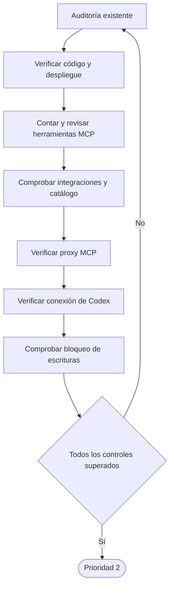
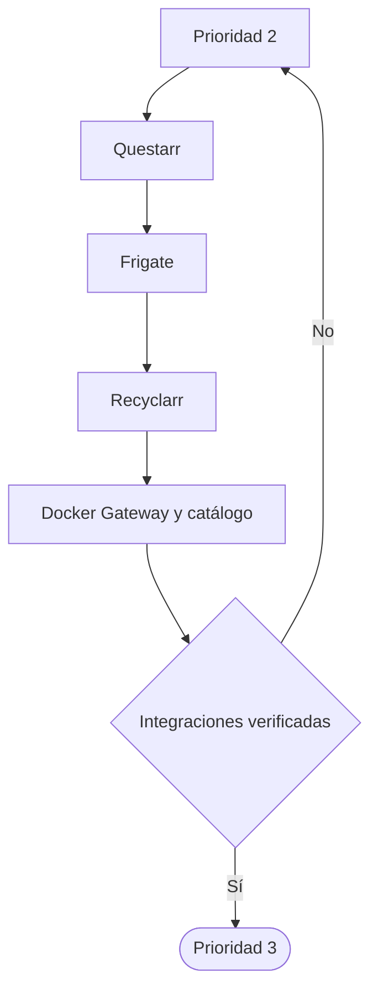

# HomeLabPilot — Flujo maestro de auditoría y desarrollo

> **Documento de referencia único para continuar el proyecto.** Antes de cada sesión de trabajo hay que leer este archivo y continuar desde el primer nodo pendiente. Después de cada tarea completada, actualizar aquí el estado y el registro.

- **Repositorio:** `rubenseglop/mcp-HomeLabPilot`
- **Rama:** `main`
- **Última actualización:** 2026-11-23
- **Fase activa:** Prioridad 1 — Comprobar todo lo existente
- **Estado global:** EN CURSO

## 1. Flujo general

## 2. Prioridad 1 — Comprobar todo lo existente

### 1.1 Código y despliegue

| Tarea | Estado | Resultado / observaciones |
|---|---|---|
| Comprobar repositorio y rama `main` | COMPLETADO | Repositorio `rubenseglop/mcp-HomeLabPilot` |
| Comprobar árbol de trabajo limpio | COMPLETADO | Sin cambios pendientes en la comprobación del 23-11-2026 |
| Contrastar commit del servidor con GitHub | COMPLETADO | `44985e1` (comprobación previa del 23-11-2026) |
| Confirmar que el contenedor ejecuta exactamente ese código | PENDIENTE | La coincidencia del repositorio no demuestra por sí sola qué código está ejecutando la imagen |

### 1.2 Herramientas MCP

| Tarea | Estado | Resultado / observaciones |
|---|---|---|
| Ejecutar `tools/list` | COMPLETADO | Respuesta JSON-RPC correcta |
| Registrar recuento real | COMPLETADO | **187 herramientas** publicadas |
| Aclarar diferencia respecto a las 189 previstas | COMPLETADO | 189 declaraciones `@mcp.tool`, 187 nombres únicos por dos nombres duplicados; coincide con `tools/list` (187) |
| Revisar herramientas duplicadas, ausentes o inesperadas | EN CURSO | Detectadas duplicaciones de `cleanuparr_get_health` y `maintainerr_get_health`; falta cotejar los 187 nombres exactos con el inventario remoto |

### 1.3 Integraciones

| Tarea | Estado | Resultado / observaciones |
|---|---|---|
| Ejecutar `stack_status` | COMPLETADO | 10 de 10 servicios configurados respondieron correctamente |
| Revisar versiones y campos no disponibles | PARCIAL | Bazarr, Seanime, Jellyfin y Tdarr no devolvieron versión; no equivale a fallo de conectividad |
| Ejecutar y revisar `integration_catalog` | PENDIENTE | Próxima comprobación funcional; clasificar configuradas, parciales y no implementadas |

### 1.4 Proxy MCP, Codex y permisos

| Tarea | Estado | Resultado / observaciones |
|---|---|---|
| Comprobar endpoint de salud del proxy | COMPLETADO | HTTP 200; modo `read-only` |
| Comprobar salud del gateway de agentes | COMPLETADO | HTTP 200 |
| Verificar autenticación/configuración MCP de Codex | PARCIAL | Gateway informó `authenticated=true` y `mcp_configured=true`; falta probar una llamada real a través del proxy |
| Ejecutar `tools/list` a través del proxy | PENDIENTE | |
| Ejecutar una herramienta de lectura a través del proxy | PENDIENTE | |
| Verificar bloqueo de herramientas de escritura en el proxy | PENDIENTE | Prueba negativa segura; no ejecutar ninguna escritura en servicios reales |
| Verificar que las lecturas siguen permitidas | PENDIENTE | |

**Criterio para cerrar Prioridad 1:** todas las tareas deben estar COMPLETADAS o tener una excepción documentada y aceptada. Los estados PARCIAL y BLOQUEADO no cierran una fase.

## 3. Prioridad 2 — Terminar las integraciones

| Tarea | Estado | Alcance |
|---|---|---|
| Questarr | PENDIENTE | Revisar presencia en catálogo, configuración, API y herramientas MCP |
| Frigate | PENDIENTE | Revisar presencia en catálogo, configuración, API y herramientas MCP |
| Recyclarr | PENDIENTE | Evaluar estado actual y diseñar integración útil, con pruebas |
| Docker Gateway | PENDIENTE | Revisar allowlist, permisos, herramientas y representación en catálogo |

## 4. Prioridad 3 — Paneles propios

| Aplicación | Estado |
|---|---|
| Plex | PENDIENTE |
| Jellyfin | PENDIENTE |
| Seerr | PENDIENTE |
| Immich | PENDIENTE |
| Tdarr | PENDIENTE |
| Home Assistant | PENDIENTE |
| RomM | PENDIENTE |
| Resto de aplicaciones, priorizadas por utilidad | PENDIENTE |

## 5. Prioridad 4 — Calidad y validación final

| Tarea | Estado |
|---|---|
| Pruebas reales de integración | PENDIENTE |
| Pruebas E2E de Docker Compose | PENDIENTE |
| Comprobar permisos de cada herramienta | PENDIENTE |
| Comprobar flujos de preview y confirmación de operaciones sensibles | PENDIENTE |
| Generar/actualizar documentación automáticamente desde el catálogo real | PENDIENTE |
| Ejecutar batería final de pruebas | PENDIENTE |
| Registrar versión y resultados finales | PENDIENTE |

## 6. Registro de comprobaciones

| Fecha | Comprobación | Resultado |
|---|---|---|
| 2026-11-23 | Repositorio, rama y commit | `main`; commit comprobado `44985e1`; árbol limpio |
| 2026-11-23 | `stack_status` | 10/10 servicios configurados responden correctamente |
| 2026-11-23 | MCP `tools/list` | 187 herramientas; sin error JSON-RPC |
| 2026-11-23 | Proxy `/health` | HTTP 200; modo `read-only` |
| 2026-11-23 | Gateway de agentes `/health` | HTTP 200; Codex autenticado y MCP configurado |

## 7. Hallazgos de auditoría en la rama de desarrollo

| Fecha | Hallazgo | Estado / acción |
|---|---|---|
| 2026-11-23 | Rama `feature/complete-homelabpilot` creada desde `main` (`a5ddc62`) | COMPLETADO; `main` permanece intacta |
| 2026-11-23 | Servidor local en `44985e1`; GitHub `main` en `a5ddc62` | CONFIRMADO; no sincronizar ni desplegar hasta completar auditoría |
| 2026-11-23 | Hash de archivos del contenedor | BLOQUEADO por `Permission denied` al usar `docker exec` con usuario predeterminado; inspeccionar usuario/permisos y repetir como root |
| 2026-11-23 | Diferencia 189/187 herramientas | RESUELTO: 189 decoradores, 187 nombres únicos; dos herramientas registradas dos veces |
| 2026-11-23 | Versionado del paquete inconsistente | ABIERTO: `pyproject.toml` declara `0.5.0`; `src/homelabpilot/__init__.py` declara `0.1.0` |
| 2026-11-23 | Proxy read-only | ABIERTO: regex actual deja fuera consultas Seanime de verificación/auditoría; revisar semántica antes de ampliar allowlist |
| 2026-11-23 | Cobertura CI | Último workflow de `main` para `a5ddc62`: ejecución 337, `success`; aún no hay ejecución de la rama de desarrollo |

## 8. Protocolo obligatorio de trabajo

1. **Al iniciar o retomar:** leer la versión de este archivo en la rama `main` de GitHub. No confiar en una copia antigua de una conversación.
2. Identificar la primera tarea PENDIENTE de la fase activa y sus dependencias.
3. Ejecutar una comprobación o cambio cada vez y esperar el resultado antes de avanzar.
4. Marcar COMPLETADO solo cuando exista evidencia verificable. Usar PARCIAL si solo se ha validado una parte y BLOQUEADO si no se puede continuar.
5. Añadir al registro fecha, comprobación y resultado relevante.
6. No repetir pruebas COMPLETADAS salvo que haya cambios posteriores que puedan invalidarlas o una incidencia que lo justifique.
7. No saltar a otra fase mientras queden tareas abiertas en la fase actual, salvo excepción explícita documentada.
8. Durante Prioridad 1, limitarse a auditar: no cambiar código, configuración ni desplegar.
9. Cuando se autoricen cambios, probarlos, actualizar este documento y subir ambos cambios a GitHub.
10. Al finalizar cada sesión, dejar el estado y el siguiente paso reflejados aquí.

**Estados permitidos:** PENDIENTE · EN CURSO · COMPLETADO · PARCIAL · BLOQUEADO.

**Siguiente paso:** continuar en Prioridad 1, apartado 1.1: confirmar qué código ejecuta realmente el contenedor. No repetir `stack_status`, `tools/list` ni los checks de salud ya registrados.
